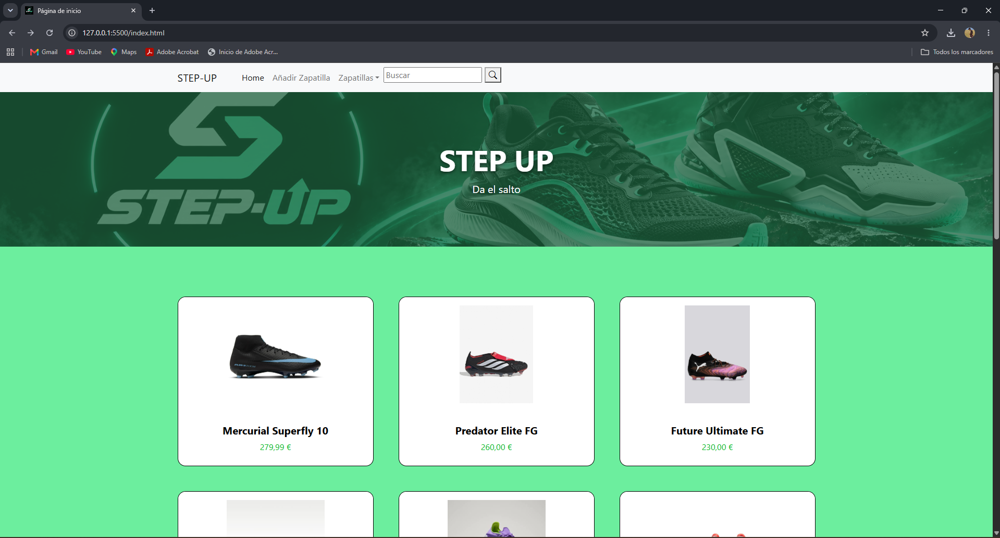
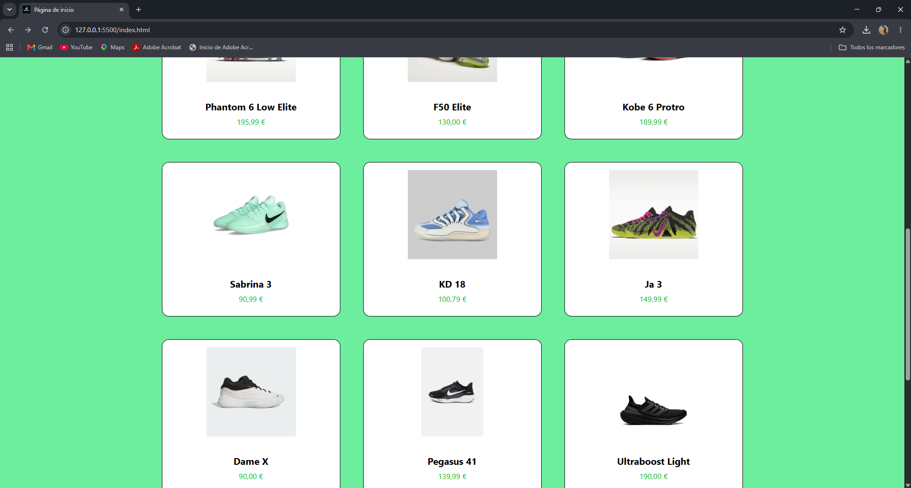
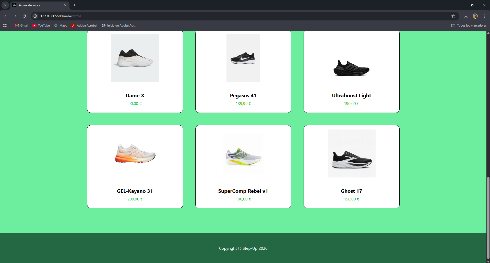
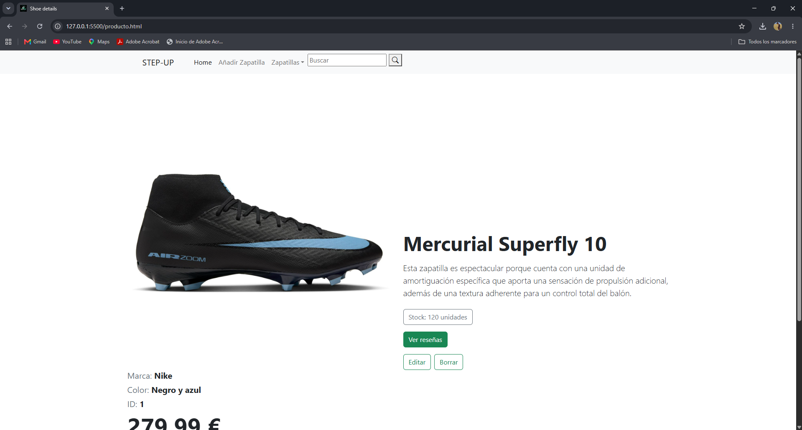
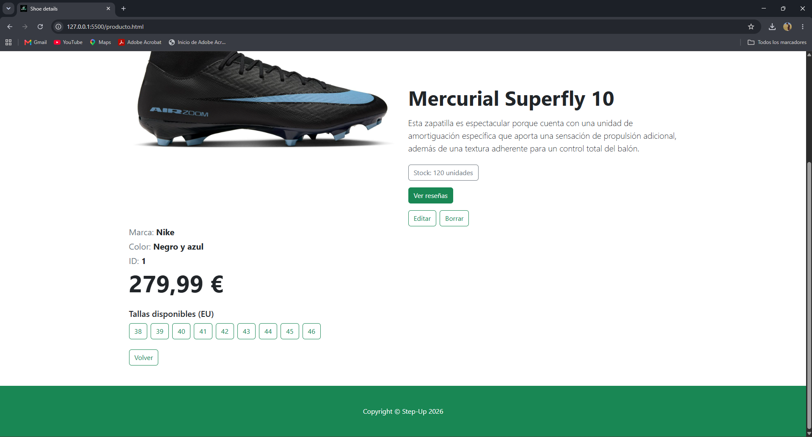
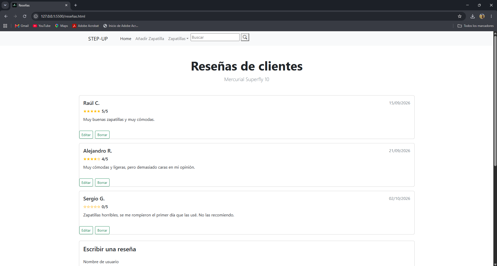
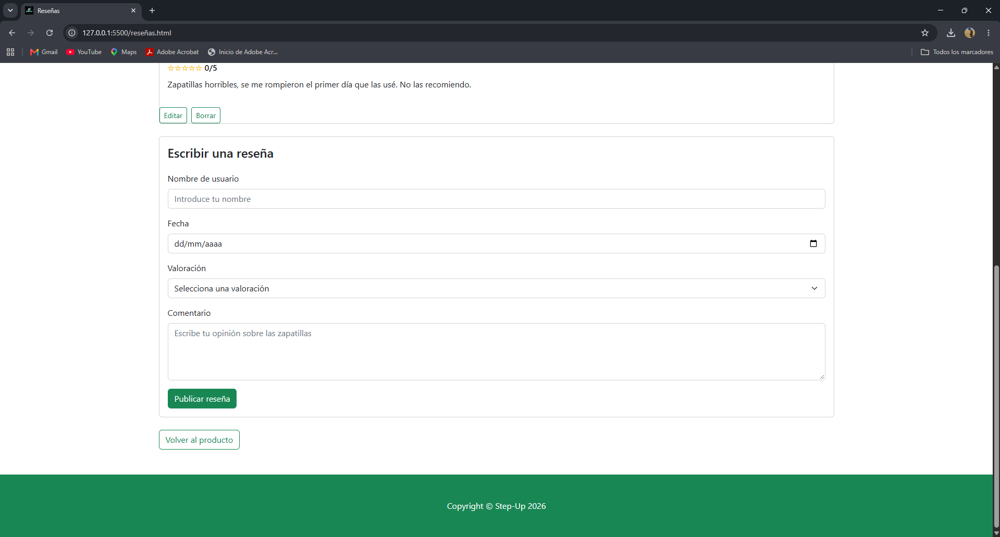
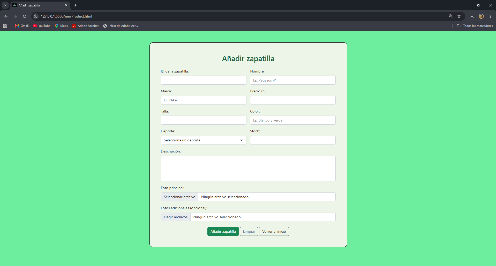

# STEP-UP
## INTEGRANTES DEL GRUPO
  - **Raúl Cabezas Vallecillo** 
    - r.cabezas.2025@alumnos.urjc.es 
    - Nombre Usuario: Raul-Bucle-Infinito
  - **Sergio García García**
    - s.garciaga.2025@alumnos.urjc.es
    - Nombre Usuario: SergioGarciiaa
  - **Alejandro Rodado López de la Reina**
    - a.rodado.2025@alumnos.urjc.es
    - Nombre Usuario: AlejandroRodado

## HERRAMIENTA DE ORGANIZACIÓN (Trello)
Link: https://trello.com/b/QeTs9v9o/step-up-web

## FUNCIONALIDAD
- Entidades:
    - **Entidad Principal: Zapatilla**
        - Id_Zapatilla
        - Name
        - Brand
        - Price
        - Size
        - Colour
        - Sport
        - Description
        - Stock
        - Photo (cada una tendrá su foto principal y después se incluirán mas fotos de distintas vistas).    

    - **Entidad Secundaria: Reseña**
        - Text
        - Rating
        - User
        - Date
     
[📊 Inventario de zapatillas](https://urjc-my.sharepoint.com/:x:/g/personal/a_rodado_2025_alumnos_urjc_es/IQBJ9jFyPAADR5sfNATojpUjAY3aylIGvh9wK7SKImZvZDo?e=rH6fZ4)

## BUSCADOR, FILTRADO o CATEGORIZACIÓN
Se incluirá un Buscador de modelo único para la entidad principal, pudiendo filtrar la búsqueda en función de los atributos que categorizan el producto como la marca, el precio o el deporte.

## Práctica 1

### Capturas de pantalla

#### Página principal

#### Página de detalle

#### Página de nuevo elemento

### Participación de los integrantes

#### Raúl Cabezas Vallecillo
En primer lugar, eliminé el botón del carrito que no resultaba necesario para los requisitos de la práctica. Añadí un cuadro de búsqueda en la parte de la cabecera, incluyendo un campo de texto y un botón con un icono de lupa para buscar, que incorporé utilizando boostrap icons.
También desarrollé la pagina de detalle de una de las zapatillas, que al principio sólo incluía imagen, descripción, nombre de la zapatilla, botón de "ver reseñas" y botón de volver a la página principal, pero que más adelante mejoré para añadir stock, id, color, etc; con el objetivo de que cuadrara con el formulario que hizo mi compañero Alejandro de "añadir zapatilla", ya que ambos debían tener los mismos datos. También añadí dos botones de edición y borrado del producto.
También hice la página completa de reseñas, donde se pueden apreciar tres reseñas "falsas" cuyo objetivo es demostrar la forma que tendrán en un futuro cuando realmente las implementemos, con celdas para cada usuario, que incluyen la valoración del usuario con estrellas (que actualmente son texto, no son reales), nombre del usuario, fecha y comentario acerca del producto, tal como se prometió en la entidad secundaria. Más adelante, añadí un formulario completo para que el usuario pudiera añadir sus propias reseñas; pudiendo (y debiendo) añadir el nombre de usuario, fecha, valoración y descripción, con los atributos que consideré más adecuados para rellenar los campos adecuadamente. Finalmente eliminé el botón de reseñas para unirlas a la pagina de detalle, como exigía la rúbrica.
Hay otros commits que hice solucionando errores importantes que la rúbrica que la práctica exigía, por ejemplo, añadir la cabecera y pie de página a la pagina de producto y nuevo producto, corregir un error que cometí con el menú desplegable y el símbolo de la lupa al hacer dicha acción, o corregir la columna con los datos de la zapatilla en la que había un espacio innecesario entre el color y el id.
Por último, cabe mencionar que todo el código que escribí fue debidamente comentado en inglés para su mejor comprensión y todo el código está en dicho idioma(excepto las palabras que vayan a ser visibles para el usuario en la web, lo que resulta evidente), lo que fue posible en parte gracias a la herramienta: Traductor de Google.

**5 commits más significativos:**
- [Barra de búsqueda] (https://github.com/CodeURJC-FW-2026-27/webapp02/commit/dc4173cf83f21be86e78bada836b66ba57ec4458)
- [Desarrollo de página] de detalle del producto (https://github.com/CodeURJC-FW-2026-27/webapp02/commit/ae9d9f885d888199877e43132f87c551ed230fad)
- [Mejora del producto que incluía marca, precio y tallas] (https://github.com/CodeURJC-FW-2026-27/webapp02/commit/2d6db360cc3234c55d379b73c30a4cd2013b6f01)
- [Página de producto casi definitiva y pagina de reseñas al completo] (https://github.com/CodeURJC-FW-2026-27/webapp02/commit/860d4daa0ac58d08beaafe42a843491e4c5b3eab)
- [Corrección de error importante tras añadir cabecera y pie de página que impedía que el menú desplegable y la lupa aparecieran] (https://github.com/CodeURJC-FW-2026-27/webapp02/commit/2e2048a127c0a386d13ffe1a5c4692800e30f853)

**5 ficheros en los que más ha participado:**
- [producto.html] (https://github.com/CodeURJC-FW-2026-27/webapp02/blame/main/producto.html)
- [index.html] (https://github.com/CodeURJC-FW-2026-27/webapp02/blame/main/index.html)
- [newProduct.html] (https://github.com/CodeURJC-FW-2026-27/webapp02/blame/main/newProduct.html)
- [README.md] (https://github.com/CodeURJC-FW-2026-27/webapp02/blame/main/README.md)
#### Sergio García García

Lo primero que hice fue poner un filtrado para las zapatillas de distintos tipo (Fútbol, Baloncesto y Running), y quitar un boton que no nos hacia falta.
Luego, como la rúbrica nos pedía que la pagina tenia que tener solo 3 articulos por línea para pantallas grandes.
Yo fui el que editó el botón de cada zapatilla para que tuviera el borde redondo, el hover, y asi se viera vas estilizado y bonito.
Luego cuando ya estaba editado el boton (div) de las zapatillas añadí todas las zapatillas que teniamos (minimo 9).
También hice otros commits arreglando cosas o poniendo cosas muy sútiles, que no tenían tanta importancia como otros mas grandes.

**5 commits más significativos:**
- [Todas las Zapatillas] (https://github.com/CodeURJC-FW-2026-27/webapp02/commit/c41b5e759fd59ff87b2cbfe30e0d855727465b06)
- [Hover de las Zapatillas] (https://github.com/CodeURJC-FW-2026-27/webapp02/commit/494c4df83b871e764be9cbc24aaf69372139a189)
- [Boton Zapatilla(div)](https://github.com/CodeURJC-FW-2026-27/webapp02/commit/3fec68a9ebc06ec37d6c17be25496a2b1998a100)
- [Poner 3 articulos fila] (https://github.com/CodeURJC-FW-2026-27/webapp02/commit/5c8166dea2b112fb4bc352383bffc9ab778e7656)
- [Filtro Zapatillas, y quitar about] (https://github.com/CodeURJC-FW-2026-27/webapp02/commit/e31dc402b013707c92ff1c0bba6c0547cabb6ad8)

**Ficheros en los que más ha participado:**
- [index.html](https://github.com/CodeURJC-FW-2026-27/webapp02/blame/main/index.html)
- [personalizado.css](https://github.com/CodeURJC-FW-2026-27/webapp02/blame/main/css/personalizado.css)
- [README.md](https://github.com/CodeURJC-FW-2026-27/webapp02/blame/main/README.md)
- [producto.html](https://github.com/CodeURJC-FW-2026-27/webapp02/blame/main/producto.html)
  

#### Alejandro Rodado López de la Reina

En términos generales me he encargado de la distribución de tareas y labores de organización, como el desarrollo del mural en Trello o el esqueleto del excel del inventario de productos, y de desarrollar mi parte correspondiente en la propia web. Esto se ve en el historial de commits con la aplicación del templeate seleccionado principalmente.
Después di forma a un .css personalizado para los botones y tarjetas de producto que trabaja sobre el propio fichero css que nos venía con la plantilla de bootstrap para así poder mantener el estilo de nuestra propia marca.
A continuación seguí dándole forma a la página principal con los colores y su formato, con el logo de la marca en la pestaña de navegación, las carpetas de las imágenes y capturas de pantalla para el readme…
Por último me encargué de la codificación del formulario de nuevo producto y de realizar correcciones en las cabeceras (Navegation) de todos los html, con los enlaces a las páginas principales y a otras disponibles en la barra de navegación de la cabecera tanto en la páginas principal como en las demás.

**5 commits más significativos:**
- [Añadir template y carpeta de imágenes de productos](https://github.com/CodeURJC-FW-2026-27/webapp02/commit/3878cd61e9ec325f2df9cea76fe779052568fc01)
- [Logo en la pestaña de navegación](https://github.com/CodeURJC-FW-2026-27/webapp02/commit/4165849ef7c46c1d0771a907d5ccfba2f4d2c325)
- [Diseño de la cabecera](https://github.com/CodeURJC-FW-2026-27/webapp02/commit/1a297b55c33108fe826742c546150fa862c74481)
- [Formulario de nuevo producto](https://github.com/CodeURJC-FW-2026-27/webapp02/commit/8dfb1561df20e8a1da12a65180ac1d1fca64eceb)
- [CSS personalizado](https://github.com/CodeURJC-FW-2026-27/webapp02/commit/ace86c53c42abd79f303c96d7d02b77b3dcc6dc8)

**Ficheros en los que más ha participado:**
- [newProduct.html](https://github.com/CodeURJC-FW-2026-27/webapp02/blame/main/newProduct.html)
- [personalizado.css](https://github.com/CodeURJC-FW-2026-27/webapp02/blame/main/css/personalizado.css)
- [index.html](https://github.com/CodeURJC-FW-2026-27/webapp02/blame/main/index.html)
- [README.md](https://github.com/CodeURJC-FW-2026-27/webapp02/blame/main/README.md)
